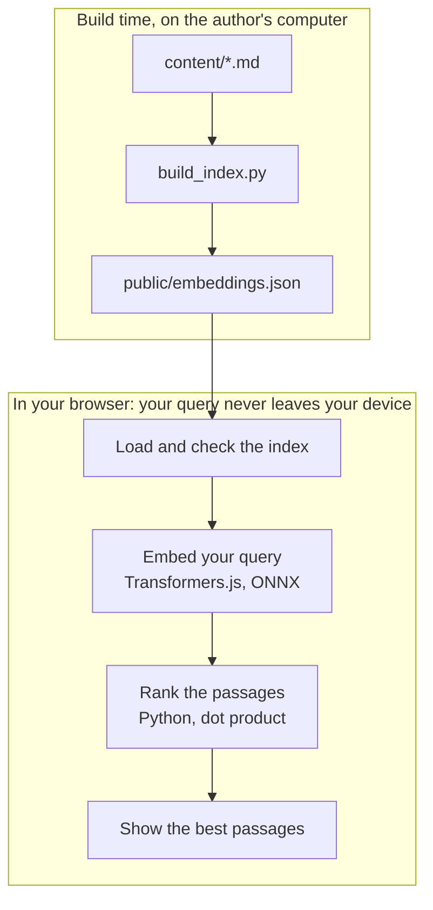

# Moritz says

Moritz says is a static semantic search page for the publications of Moritz Mähr.
The page finds passages by meaning, in German and in English.
GitHub Pages is the only host. There is no application server.

`SPEC.md` is the product specification.

## Warning: all content is public

Each text in `content/` and each embedding in `public/embeddings.json` is public.
A visitor can read the full texts in the published index.
Do not add confidential or access-restricted text.

## How it works

1. `scripts/build_index.py` splits each text in `content/` into passages of 120 to 180 tokens.
2. The script calculates one embedding for each passage with a pinned Python model.
3. The script writes the passages and the embeddings to `public/embeddings.json`.
4. `app.py` is a marimo notebook. marimo exports it as a WebAssembly page.
5. The page loads the index and validates it.
6. A pinned ONNX model calculates the query embedding in the browser.
7. Python ranks the passages by dot product and shows the best passages, grouped by work.




The query does not leave the browser. No inference service gets the query or a text.

The browser downloads the runtime, the Python packages, and the model files from these hosts:
`cdn.jsdelivr.net`, `files.pythonhosted.org`, `pypi.org`, `wasm.marimo.app`, and `huggingface.co` with its file hosts.
The first visit needs a network connection. The first search downloads a model of about 120 MB.

## Models

| Use | Model | Where to pin |
| --- | --- | --- |
| Passages, at build time | `intfloat/multilingual-e5-small` | `MODEL` in `scripts/build_index.py` |
| Queries, in the browser | `Xenova/multilingual-e5-small`, `q8` | `MODEL` in `scripts/build_index.py`, `QUERY_DTYPE` in `app.py` |
| Browser runtime | Transformers.js | `TRANSFORMERS_JS_URL` in `app.py` |

Each model has a pinned revision. The index records the model names and the revisions.
The page reads the query model from the index. Thus the query model always agrees with the index.

## Set up

```bash
uv sync --locked
```

## Change the corpus

1. Put a Markdown or plain-text file in `content/`.
2. Start the file with front matter that has a `title` and, optionally, a `url`.
3. Build the index:

   ```bash
   uv run --group index python -m scripts.build_index
   ```

4. Run the gate.
5. Commit the text, `public/embeddings.json`, and `tests/fixtures/reference_vectors.json` together.

Do not edit `public/embeddings.json` by hand.
A `url` must be a relative link or an `https://doi.org/` link. `APPROVED_URL_HOSTS` in `app.py` holds the approved hosts.

Front matter example:

```markdown
---
title: "The title of the work"
url: "https://doi.org/10.5281/zenodo.11124720"
---
```

## Gate

```bash
uv run ruff check . && uv run ruff format --check .
uv run ty check
uv run pytest
uv run marimo check app.py --select MW
```

## Local check

```bash
uv run python -m scripts.export_site
python -m http.server --directory dist 8000
```

Open `http://localhost:8000/`. Do not open `dist/index.html` as a file.

## Browser tests

The browser tests run real WebAssembly inference in Chromium and in Firefox.
They need the export in `dist/` and a network connection. CI does not run them.
Run them before each release:

```bash
uv run python -m scripts.export_site
uv run playwright install chromium firefox
uv run pytest -m browser --no-cov
```

## Deployment

`.github/workflows/pages.yml` runs the gate and the export for each pull request and each push to `main`.
Only `main` deploys. The deployment needs a successful build.
In the repository settings, set the Pages source to **GitHub Actions**.

## Licence

The code has the licence AGPL-3.0-only. Refer to `LICENSE`.
Each text in `content/` keeps the licence of its publication.
